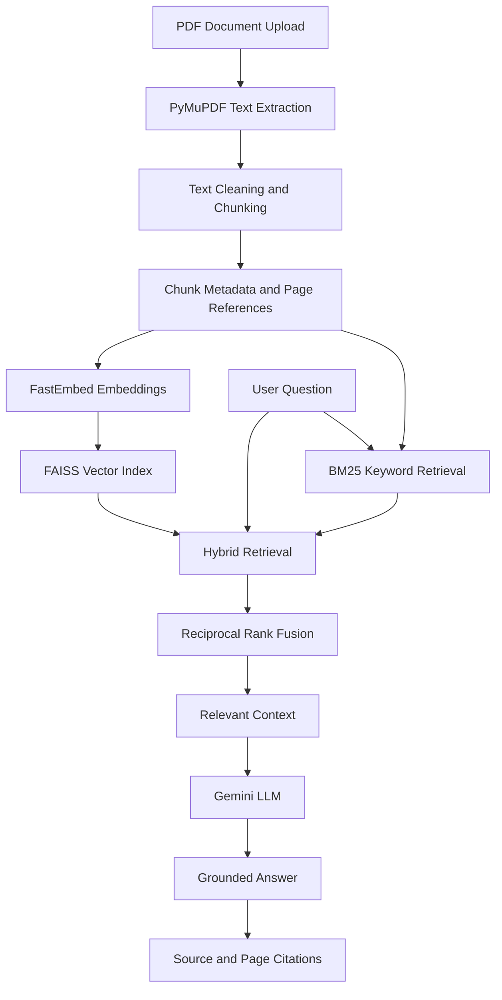

# DocuMind AI – RAG-Based Document Question Answering System

**An intelligent document question-answering system that allows users to upload PDF documents and retrieve accurate, context-grounded answers using Retrieval-Augmented Generation (RAG).**

DocuMind AI transforms static  documents searchable knowledge sources. Instead of manually browsing lengthy PDFs, users can ask natural-language questions and receive answers generated from relevant document content, with source-page citations.

---

## Overview

Finding specific information in lengthy academic documents can be time-consuming. Traditional keyword search often fails when users phrase questions differently from the original document.

DocuMind AI addresses this problem through a Retrieval-Augmented Generation pipeline that combines semantic search, keyword-based retrieval, and Large Language Model (LLM) generation.

The system processes uploaded PDF documents, extracts and chunks their content, generates vector embeddings, and stores them in a FAISS index. When a user submits a question, the system retrieves relevant passages using hybrid retrieval and passes the evidence to Gemini to generate a context-grounded response.

The application is built with **FastAPI, Streamlit, FAISS, BM25, FastEmbed, and Google Gemini**.

## Key Features

- **PDF Document Processing:** Upload and process PDF documents for question answering.
- **Text Extraction:** Extract text from PDF pages using PyMuPDF while preserving page-level metadata.
- **Intelligent Chunking:** Divide extracted text into smaller overlapping chunks for effective retrieval.
- **Semantic Search:** Generate embeddings using FastEmbed and retrieve semantically relevant content.
- **Keyword-Based Search:** Use BM25 to retrieve documents based on lexical relevance.
- **Hybrid Retrieval:** Combine dense semantic retrieval and BM25 keyword retrieval using Reciprocal Rank Fusion (RRF).
- **Context-Grounded Answers:** Generate responses using Google Gemini based on retrieved document evidence.
- **Source Citations:** Include document and page references to help users locate supporting information.
- **Unsupported Question Handling:** Apply answer-quality safeguards to avoid generating unsupported answers when the retrieved evidence is insufficient.
- **REST API:** Provide backend functionality through FastAPI.
- **Interactive Interface:** Use Streamlit for document interaction and question answering.
- **Persistent Storage:** Store document metadata and application records using SQLite.
- **Dockerized Deployment:** Run the application using Docker Compose.

## System Architecture



## RAG Pipeline

### 1. Document Ingestion

- Users upload PDF documents.
- PyMuPDF extracts text page by page.
- Extracted content is cleaned and prepared for processing.
- Page information is retained as metadata.

### 2. Text Chunking

Long documents are divided into smaller text chunks with overlapping content.

Chunking helps the retrieval system identify relevant passages without processing an entire document for every question.

### 3. Embedding Generation

FastEmbed converts text chunks into numerical vector representations.

These embeddings capture semantic information and enable similarity-based retrieval.

### 4. Vector Storage

FAISS stores and searches the generated embeddings.

The vector retrieval process identifies passages that are semantically similar to the user's question.

### 5. Hybrid Retrieval

DocuMind AI combines two retrieval approaches:

- **Dense Retrieval:** Uses embeddings and FAISS for semantic similarity search.
- **Sparse Retrieval:** Uses BM25 for keyword-based relevance matching.

Reciprocal Rank Fusion (RRF) combines the rankings from both retrieval methods to produce a unified set of relevant passages.

### 6. Answer Generation

The retrieved passages are passed to Google Gemini along with the user's question.

The generation process uses contextual instructions to:

- Answer using the supplied document evidence.
- Avoid unsupported assumptions.
- Provide relevant source references.
- Handle questions when sufficient supporting evidence is unavailable.

### 7. Response and Citations

The generated response is returned through the application interface, together with source and page references for verification.

## Technology Stack

| Component | Technology |
|---|---|
| Programming Language | Python |
| Frontend | Streamlit |
| Backend | FastAPI |
| LLM | Google Gemini |
| Embedding Model | FastEmbed |
| Vector Search | FAISS |
| Keyword Retrieval | BM25 |
| Hybrid Retrieval | Reciprocal Rank Fusion |
| PDF Processing | PyMuPDF |
| Database | SQLite |
| Containerization | Docker, Docker Compose |
| Deployment | AWS EC2 |
| Reverse Proxy | Nginx |
| Version Control | Git, GitHub |

## Project Structure

```text
documind-ai/
│
├── app/
│   ├── __init__.py
│   ├── answer_generator.py
│   ├── api.py
│   ├── chunker.py
│   ├── database.py
│   ├── document_service.py
│   ├── embedder.py
│   ├── pdf_loader.py
│   ├── retrieval.py
│   └── vector_store.py
│
├── evaluation/
│   ├── questions.json
│   └── test_questions.json
│
├── tests/
│   ├── test_citation_ids.py
│   ├── test_generalized_rag.py
│   └── test_quality_guards.py
│
├── answer_quality_cases.json
├── evaluation_questions.json
│
├── Dockerfile
├── docker-compose.yml
├── requirements-deploy.txt
├── frontend_streamlit_api.py
├── streamlit_app.py
├── ask.py
├── build_embeddings.py
│
├── .env.example
├── .gitignore
└── README.md
```

*Additional scripts in the repository support retrieval debugging, evaluation, testing, and inspection.*

## Installation and Setup

### Prerequisites

- Python 3.11
- Git
- Google Gemini API key
- Docker and Docker Compose (for containerized execution)

### 1. Clone the Repository

```bash
git clone https://github.com/KrishnaPriya030/documind-ai.git
cd documind-ai
```

### 2. Create a Virtual Environment

**Windows PowerShell:**

```powershell
python -m venv .venv
.venv\Scripts\Activate.ps1
```

### 3. Install Dependencies

```bash
pip install -r requirements-deploy.txt
```

### 4. Configure Environment Variables

Create a `.env` file in the project root.

```env
GEMINI_API_KEY=your_gemini_api_key
GEMINI_MODEL=gemini-2.5-flash-lite
DEBUG_PROMPT=0
APP_ACCESS_PASSWORD=your_application_password
```

Replace the placeholder values with your own credentials.

**Important:** Never commit your actual `.env` file or expose API keys publicly.

### 5. Run the Backend

```bash
uvicorn app.api:app --reload
```

The FastAPI backend will be available at:

```text
http://127.0.0.1:8000
```

API documentation:

```text
http://127.0.0.1:8000/docs
```

### 6. Run the Frontend

Open another terminal, activate the virtual environment, and run:

```bash
streamlit run frontend_streamlit_api.py
```

The Streamlit application will be available at:

```text
http://localhost:8501
```

*Note: Local execution requires the configured environment variables and any application data or indexes required by the selected workflow.*

## Docker Deployment

DocuMind AI supports containerized execution using Docker Compose.

Configure the environment variables in `.env`, then run:

```bash
docker compose up --build -d
```

Check running containers:

```bash
docker compose ps
```

View application logs:

```bash
docker compose logs -f
```

Stop the application:

```bash
docker compose down
```

Persistent Docker volumes are configured for application data, indexes, and model cache.

## Testing and Evaluation

The repository includes test scripts and evaluation datasets to examine different parts of the RAG pipeline.

Testing areas include:

- PDF text extraction.
- Text chunking.
- Embedding generation.
- Vector similarity retrieval.
- Hybrid retrieval.
- Citation ID validation.
- Generalized RAG behavior.
- Answer-quality safeguards.

Evaluation questions are based on publicly available university academic and regulatory documents.

The evaluation datasets help assess whether the system retrieves relevant evidence and generates answers grounded in the supplied context.

**Evaluation metrics of interest:**

- Precision
- Recall
- F1-score
- Retrieval relevance
- Answer correctness
- Citation accuracy

These metrics should be reported with measured results from the evaluation scripts rather than assumed values.

## Deployment

The application has been deployed on an AWS EC2 Ubuntu server using Docker Compose and Nginx as a reverse proxy.

The deployment separates the FastAPI backend and Streamlit frontend into services, with persistent Docker volumes for application data and indexes.

## Security and Configuration

- API keys and application credentials are managed through environment variables.
- Sensitive files and local application data are excluded through `.gitignore`.
- Docker services use internal service communication.
- The Streamlit application supports an optional shared-password access gate.

The shared-password gate is not a replacement for individual user authentication or per-user document access controls.

## Current Limitations

- Answer quality depends on the quality of extracted PDF text and retrieved evidence.
- Scanned PDFs may require OCR processing.
- Similarity-based retrieval can return irrelevant passages for ambiguous or unrelated questions.
- Citation presence does not independently guarantee that a citation fully supports the generated claim.
- Retrieval thresholds and answer-quality safeguards require evaluation across more documents and question types.
- Individual user authentication and per-user document isolation are not currently implemented.

## Future Improvements

- Improve retrieval using cross-encoder reranking.
- Introduce more comprehensive RAG evaluation.
- Improve OCR support for scanned documents.
- Implement user authentication and document-level access control.
- Add document-level filtering and more advanced metadata retrieval.
- Improve citation-grounding validation.
- Introduce monitoring and performance optimization.

## Learning Outcomes

This project provided practical experience with:

- Understanding and implementing a complete RAG pipeline.
- Working with text embeddings and vector databases.
- Combining semantic and keyword-based retrieval.
- Integrating LLMs into backend applications.
- Building REST APIs using FastAPI.
- Developing interactive applications using Streamlit.
- Evaluating retrieval and answer-generation quality.
- Containerizing applications and deploying them on AWS EC2.

## Acknowledgements

The evaluation datasets use questions based on publicly available university academic and regulatory documents. Original source documents are not included in this repository.

## Author

**Krishna Priya S**

MCA Student | Interested in Artificial Intelligence, Machine Learning, and Generative AI.

**GitHub:** [KrishnaPriya030](https://github.com/KrishnaPriya030)

---

